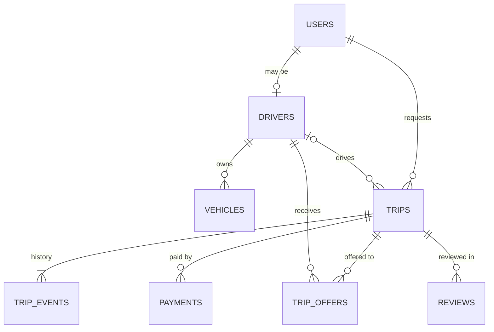
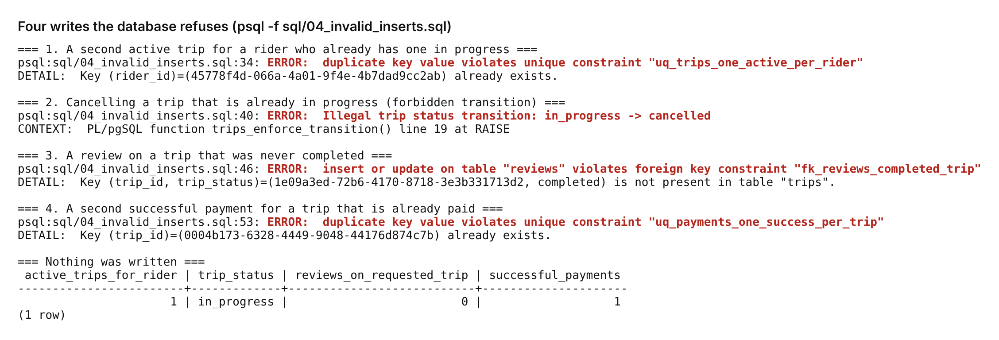
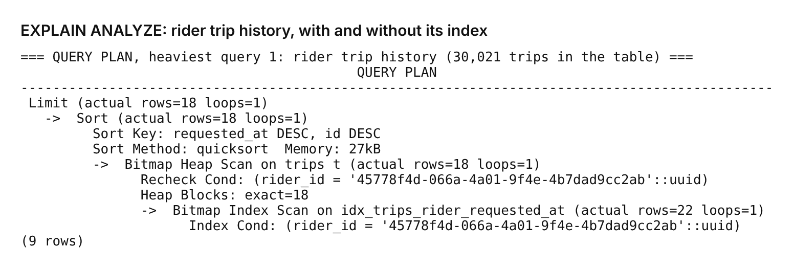
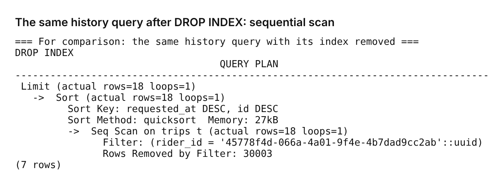
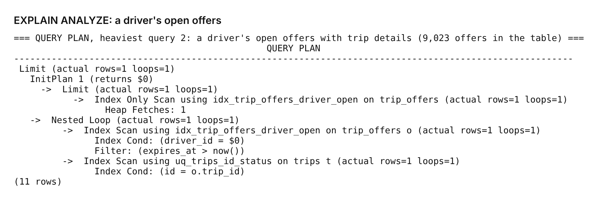
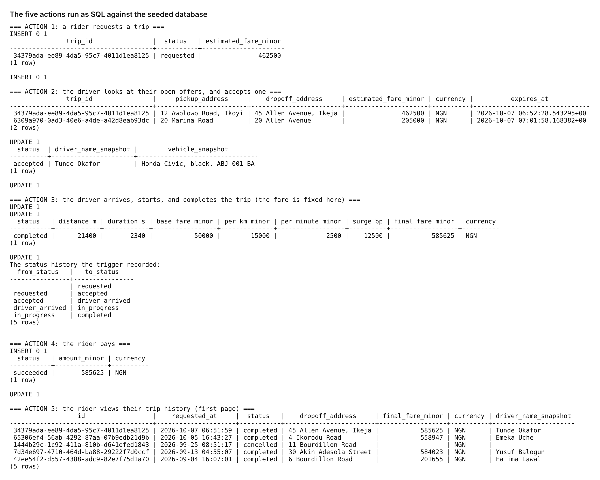

# API Design & Data Modeling: a ride-hailing service

A data model and API contract for a ride-hailing product, designed on paper first, then built as a real PostgreSQL schema, seeded with realistic data, and attacked with writes it must refuse.

Nothing here is an application. The point of the task is that the **database itself** holds the rules.

## What is in this repo

| Path | What |
| --- | --- |
| [`docs/01-requirements.md`](docs/01-requirements.md) | the product, the five important actions, the rules |
| [`docs/02-data-model.md`](docs/02-data-model.md) | ER diagram, entities, fields, types, cardinalities |
| [`docs/03-hard-questions.md`](docs/03-hard-questions.md) | normalisation, money, state, time, identifiers, constraints, indexes |
| [`docs/04-api-contracts.md`](docs/04-api-contracts.md) | endpoints for the five actions: requests, responses, errors, idempotency |
| [`docs/05-overfetching-and-realtime.md`](docs/05-overfetching-and-realtime.md) | REST vs GraphQL for trip history; polling vs SSE vs WebSockets |
| [`sql/01_schema.sql`](sql/01_schema.sql) | the schema: 8 tables, enums, constraints, triggers, indexes |
| [`sql/02_seed.sql`](sql/02_seed.sql) | deterministic seed: 2,000 users, 300 drivers, 30,020 trips |
| [`sql/03_queries.sql`](sql/03_queries.sql) | the five actions as SQL, plus `EXPLAIN ANALYZE` on the two heaviest |
| [`sql/04_invalid_inserts.sql`](sql/04_invalid_inserts.sql) | four writes the database refuses |
| [`sql/05_rating_cache_check.sql`](sql/05_rating_cache_check.sql) | proves the denormalised rating totals stay correct |
| [`evidence/`](evidence) | the output of running all of the above |

## The model in one picture



## Run it

Needs PostgreSQL 13 or newer and `psql`. Nothing else.

```bash
createdb ridehail
export DATABASE_URL=postgresql://localhost/ridehail

psql "$DATABASE_URL" -v ON_ERROR_STOP=1 -f sql/01_schema.sql
psql "$DATABASE_URL" -v ON_ERROR_STOP=1 -f sql/02_seed.sql
psql "$DATABASE_URL" -v ON_ERROR_STOP=1 -f sql/03_queries.sql       # five actions + query plans
psql "$DATABASE_URL" -f sql/04_invalid_inserts.sql                  # errors are the expected output
psql "$DATABASE_URL" -f sql/05_rating_cache_check.sql
```

`03`, `04` and `05` roll back what they do, so they can be run repeatedly.

## Decisions that matter most

1. **Money is integer minor units plus a currency code.** Never a float. Surge is integer basis points. One rounding rule.
2. **The trip keeps the price it was quoted at.** Tariff, driver name and vehicle are copied onto the trip. A deliberate denormalisation so old receipts stay true.
3. **The state machine lives in the database.** A trigger refuses any status change that is not on the diagram.
4. **`in_progress → cancelled` is forbidden.** Once the rider is in the car, the trip can only be completed, at whatever distance was driven. Otherwise cancelling is a free ride.
5. **"Only one" rules are partial unique indexes**, not application checks: one active trip per rider, per driver, one accepted offer per trip, one successful payment per trip. They hold under concurrency.
6. **UUIDs for anything exposed**, soft delete for people and vehicles, no delete at all for trips and payments.

The reasoning for each is in [`docs/03-hard-questions.md`](docs/03-hard-questions.md).

## Evidence

All produced by running the scripts in this repo against the seeded database (PostgreSQL 16).

**The database refusing bad writes** ([text](evidence/invalid-inserts-output.txt))



**Query plan: rider trip history, using its index** ([full output](evidence/queries-output.txt))



**The same query with the index dropped: a sequential scan discarding 30,003 rows**



**Query plan: a driver's open offers**



**The five actions, end to end, for one trip**



**Denormalised rating totals match the reviews**: 0 mismatches across 300 drivers, after seeding and after changing 50 ratings and soft-deleting 50 reviews ([output](evidence/rating-cache-check.txt)).

## What went wrong while building it

- **The rating cache was only half maintained.** My first trigger updated the totals on a new review only. Writing the documentation, I claimed it also handled edits and soft deletes, checked the code, and it did not. I rewrote the trigger and added `sql/05_rating_cache_check.sql` to prove it.
- **The index was not used the way I expected.** I built `(rider_id, requested_at DESC)` expecting an ordered index walk with no sort. Postgres does a bitmap scan and sorts 18 rows, because that is cheaper for a rider with few trips. The index still removes the full scan; the ordering half only pays for heavy riders. I left the real plan in.
- **The seed fought the constraints.** Loading historical completed trips directly is refused by the "a trip is born requested" trigger, as it should be. The seed disables that one trigger while loading history and re-enables it; every other constraint stays on during the load.
- **The first rejected-write script assumed the seed contained an in-progress trip.** It did not, so the script now builds its own fixture inside a transaction.

## Limits

- The API is a contract, not running code. The SQL behind each endpoint is real and run.
- No geospatial queries. Finding nearby drivers needs PostGIS and a live-location store.
- The seed is generated, with evenly spread riders. Real traffic is skewed, and plans for a very heavy rider would differ.
- Measured on one machine at 30,000 trips, not at millions.
