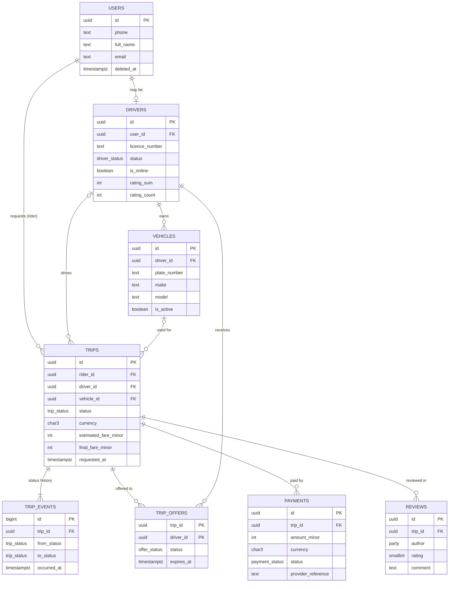

# Data model

The schema is `sql/01_schema.sql`. This page is the map.

## ER diagram

## Cardinalities in words

| Relationship | Cardinality | Enforced by |
| --- | --- | --- |
| user → driver profile | 1 to 0..1 | `uq_drivers_user` |
| driver → vehicles | 1 to many, at most one active | `uq_vehicles_one_active_per_driver` |
| user (rider) → trips | 1 to many, at most one active | FK, `uq_trips_one_active_per_rider` |
| driver → trips | 0..1 to many, at most one active | FK (nullable), `uq_trips_one_active_per_driver` |
| trip → trip_events | 1 to 1..many | trigger writes one on insert and on every status change |
| trip ↔ driver via trip_offers | many to many, one accepted per trip | PK `(trip_id, driver_id)`, `uq_trip_offers_one_accepted_per_trip` |
| trip → payments | 1 to many attempts, at most one succeeded | `uq_payments_one_success_per_trip` |
| trip → reviews | 1 to 0..2, one per side, completed trips only | `uq_reviews_one_per_side`, `fk_reviews_completed_trip` |

## Entities and fields

Every table also has `created_at` and `updated_at` (`timestamptz`, UTC), the latter set by a trigger.

### users
| Field | Type | Notes |
| --- | --- | --- |
| id | uuid PK | random, safe to expose |
| phone | text, required | E.164 checked; unique among live users |
| full_name | text, required | not blank |
| email | text, optional | |
| deleted_at | timestamptz | soft delete |

### drivers
| Field | Type | Notes |
| --- | --- | --- |
| id | uuid PK | |
| user_id | uuid FK users, unique | |
| licence_number | text, unique | |
| status | enum `pending_approval, active, suspended` | |
| is_online | boolean | only allowed when active and not deleted |
| rating_sum, rating_count | integer | cache of reviews, kept by trigger |
| deleted_at | timestamptz | soft delete |

### vehicles
| Field | Type | Notes |
| --- | --- | --- |
| id | uuid PK | |
| driver_id | uuid FK drivers | |
| plate_number | text | unique among live vehicles |
| make, model, colour | text | |
| year | smallint | 1990 to 2100 |
| is_active | boolean | one active per driver |
| deleted_at | timestamptz | soft delete |

### trips
| Field | Type | Notes |
| --- | --- | --- |
| id | uuid PK | |
| rider_id | uuid FK users, required | |
| driver_id, vehicle_id | uuid FK, null until accepted | |
| status | enum `requested, accepted, driver_arrived, in_progress, completed, cancelled, expired` | changed only along the state machine |
| pickup_lat/lng, dropoff_lat/lng | double precision | range checked |
| pickup_address, dropoff_address | text | as shown to the rider |
| currency | char(3) | ISO 4217 |
| base_fare_minor, per_km_minor, per_minute_minor | integer | tariff snapshot, minor units |
| surge_bp | integer | basis points, 10000 = 1.00x |
| estimated_fare_minor | integer | |
| distance_m, duration_s, final_fare_minor | integer, null until completed | |
| driver_name_snapshot, vehicle_snapshot | text | as they were at acceptance |
| requested_at … cancelled_at | timestamptz | one per status, checked to be in order |
| cancelled_by, cancellation_reason | enum party, text | required when cancelled |

### trip_events
Append-only. `id bigint` identity (internal, never exposed), `trip_id`, `from_status`, `to_status`, `occurred_at`.

### trip_offers
PK `(trip_id, driver_id)`, `status` enum `offered, accepted, declined, expired`, `offered_at`, `expires_at`, `responded_at`.

### payments
| Field | Type | Notes |
| --- | --- | --- |
| id | uuid PK | |
| trip_id | uuid FK trips | |
| amount_minor | integer > 0 | |
| currency | char(3) | |
| status | enum `pending, succeeded, failed, refunded` | |
| provider_reference | text, unique | our reference sent to the provider; the idempotency key |
| failure_reason | text | required when failed |

### reviews
`id`, `trip_id` + `trip_status` (always `completed`, composite FK to `trips (id, status)`), `author` (`rider` or `driver`), `rating` 1 to 5, `comment`, `deleted_at`.
