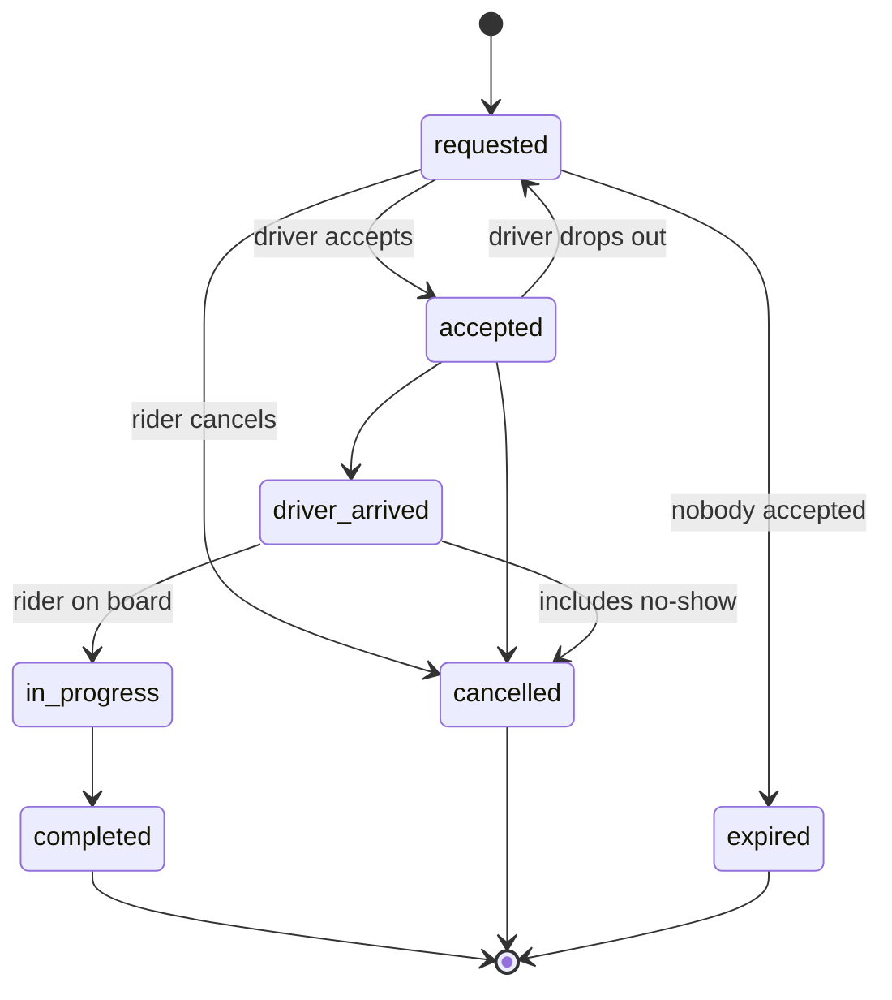

# The seven hard questions

## 1. Normalisation, and where I broke it on purpose

The schema is in third normal form by default: a user's name lives in `users`, a plate number in `vehicles`, a rating in `reviews`. Three places duplicate data deliberately.

| Denormalisation | What is copied | Why | What keeps it honest |
| --- | --- | --- | --- |
| Tariff on the trip | `base_fare_minor`, `per_km_minor`, `per_minute_minor`, `surge_bp` | Prices change. A trip must be billed at the price the rider was shown, and a receipt from last year must still add up. | Written once at request time. The final fare is computed from these columns, never from a current price list. |
| Driver and vehicle snapshot | `driver_name_snapshot`, `vehicle_snapshot` | A receipt says who drove and in which car *then*. Drivers change cars and names. It also makes trip history a single-table read. | Written once at acceptance. The live rows are still reachable through `driver_id` and `vehicle_id`. |
| Rating cache | `drivers.rating_sum`, `rating_count` | Every driver card shows an average. Aggregating `reviews` each time is wasted work. | A trigger on `reviews` adjusts the totals on insert, update, soft delete. After seeding, the totals equal `SUM`/`COUNT` over reviews for all 300 drivers. |

I store sum and count rather than an average because an average cannot be updated correctly from one new rating, and it would be a decimal.

The cost of each: more columns, and for the cache, a second place a bug could put a wrong number. That is why the cache is maintained in the database and not in application code.

## 2. Money

Every amount is an **integer number of minor units** (kobo) in a column ending `_minor`, with a `currency char(3)` beside it. No `float`, no `numeric` with a fractional part.

- Floats cannot represent 0.1 exactly, so sums drift.
- The surge multiplier is also an integer: basis points (`12500` = 1.25x).
- The fare formula is integer arithmetic with one defined rounding (integer division, rounding down): `(base + metres × per_km / 1000 + seconds × per_minute / 60) × surge_bp / 10000`. The run in `evidence/queries-output.txt` gives 585,625 kobo for 21.4 km and 39 minutes at 1.25x.
- `integer` holds about ₦21.4 million in kobo, far above any fare. A payouts ledger would use `bigint`.
- A payment stores its own amount and currency: it records what was charged, which is a fact of its own.

## 3. State

`status` is a Postgres enum, so a misspelt status cannot be stored. The transitions are enforced by the trigger `trg_trips_enforce_transition`: any change not in the diagram raises an error, whoever attempts it.

**The non-obvious forbidden transition: `in_progress → cancelled`.** It looks reasonable ("the rider wants out"), and most first drafts allow it. But once the rider is in the car, distance has been driven and money is owed. Ending early is a *completion* at the point reached, with the shorter distance and a real fare. Allowing a cancel here would be a way to ride for free. Evidence: `evidence/rejected-writes.png`, attempt 2.

Others worth naming: nothing leaves `completed`, `cancelled` or `expired`; `requested → in_progress` cannot skip acceptance; a trip cannot be inserted in any status but `requested` (`trg_trips_initial_status`).

Check constraints tie the columns to the status: a completed trip must have a fare, distance and duration; a cancelled trip must say when and by whom; a trip with no driver cannot be past `requested`.

`trip_events` records every change, written by a trigger, so the history cannot be forgotten by application code.

## 4. Time and deletion

- All timestamps are `timestamptz`, stored in UTC. The client converts to local time. `timestamp` without a zone is never used.
- A trip has one timestamp per status, and `chk_trips_times_in_order` refuses an arrival before an acceptance.
- **Soft delete** (`deleted_at`) on users, drivers, vehicles and reviews. Trips and payments point at them, and that history must survive an account closure. Foreign keys are `ON DELETE RESTRICT`, so a hard delete of a referenced row fails.
- Uniqueness is on *live* rows (`uq_users_phone_live ... WHERE deleted_at IS NULL`), so a phone number can be reused after an account closes.
- Trips, payments and trip_events have no delete path at all: they are the ledger.
- Cost of soft delete: every read of those tables must remember `deleted_at IS NULL`. Personal-data erasure would be done by overwriting the name and phone on the soft-deleted row, keeping the row.

## 5. Identifiers

- Everything exposed has a **UUID v4** primary key. Sequential ids in a URL leak how many trips the business does and let anyone walk `/trips/1001`, `/trips/1002`. A UUID still needs an ownership check, it just is not guessable.
- UUIDs can be generated by the client or by any server with no coordination.
- Cost: 16 bytes against 8, and random inserts spread across the index. At this scale that is not measurable. UUID v7 (time-ordered) would be the next step.
- `trip_events.id` is a `bigint` identity: it is never exposed, it is the highest-volume table, and insertion order is useful.
- `trip_offers` has a natural composite key `(trip_id, driver_id)`: a surrogate would only allow duplicates.
- `payments.provider_reference` is our reference, unique, sent to the payment provider. It is how a retried request or a repeated webhook is recognised.

## 6. Constraints: what the database refuses

The rules in the requirements are enforced by the database, so a bug, a script or a second server cannot break them.

| Rule | Mechanism |
| --- | --- |
| One active trip per rider | partial unique index `uq_trips_one_active_per_rider` |
| One active trip per driver | partial unique index `uq_trips_one_active_per_driver` |
| One driver wins a trip | partial unique index `uq_trip_offers_one_accepted_per_trip` |
| Legal status changes only | trigger `trg_trips_enforce_transition` |
| One successful payment per trip | partial unique index `uq_payments_one_success_per_trip` |
| Reviews only on completed trips | composite FK `fk_reviews_completed_trip` to `trips (id, status)` |
| One review per side | `uq_reviews_one_per_side` |
| Rating 1 to 5, amounts not negative, coordinates in range, phone in E.164 | check constraints |
| Only an active driver can be online | `chk_drivers_online_only_if_active` |

Partial unique indexes matter for concurrency. "Check then insert" in application code has a gap two requests can both pass through. The index has no gap: the second write fails.

`sql/04_invalid_inserts.sql` attempts four of these and all four are refused (`evidence/rejected-writes.png`, text in `evidence/invalid-inserts-output.txt`).

## 7. Indexes

Each index exists for a named query. Primary keys and unique constraints already index their columns.

| Index | Serves |
| --- | --- |
| `idx_trips_rider_requested_at (rider_id, requested_at DESC)` | rider trip history |
| `idx_trips_driver_completed_at (driver_id, completed_at DESC) WHERE status = 'completed'` | driver earnings and past trips |
| `idx_trip_offers_driver_open (driver_id, offered_at DESC) WHERE status = 'offered'` | a driver's open offers, polled often |
| `idx_drivers_online (id) WHERE is_online` | dispatch looking for available drivers |
| `idx_payments_trip`, `idx_trip_events_trip`, `idx_vehicles_driver` | child rows of one parent |

Measured with `EXPLAIN ANALYZE` on 30,021 trips (`evidence/queries-output.txt`):

- **Trip history** uses `idx_trips_rider_requested_at` and touches 18 heap blocks. With the index dropped, the same query is a sequential scan that reads all rows and discards 30,003 (`evidence/query-plan-trip-history.png`, `evidence/query-plan-without-index.png`).
- **Open offers** uses `idx_trip_offers_driver_open`, then one primary-key lookup per trip (`evidence/query-plan-driver-offers.png`).

An honest note on the first plan: Postgres chose a bitmap scan and a small sort rather than reading the index in order, because a rider has about 15 trips, so sorting 18 rows is cheaper than an ordered walk. The `requested_at DESC` half of the index pays off for a rider with thousands of trips. I did not force the other plan to make the screenshot look better.

Not indexed, on purpose: `status` alone (few distinct values), addresses, coordinates. Finding nearby drivers needs a geospatial index (PostGIS), which is out of scope here.
